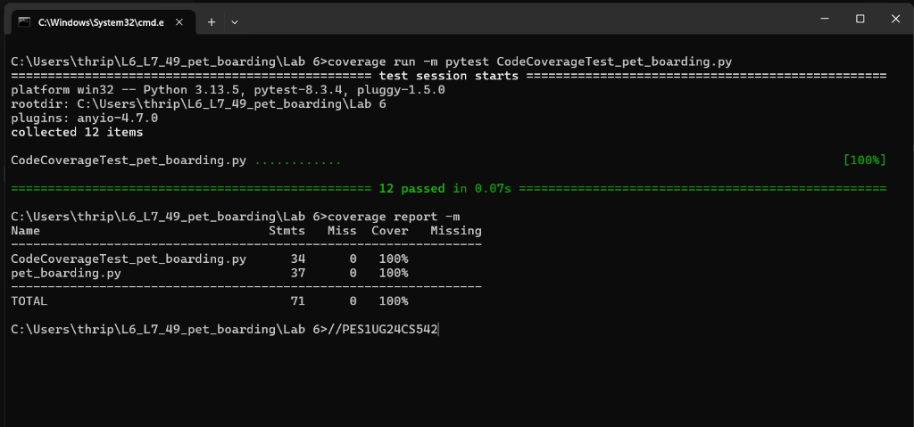
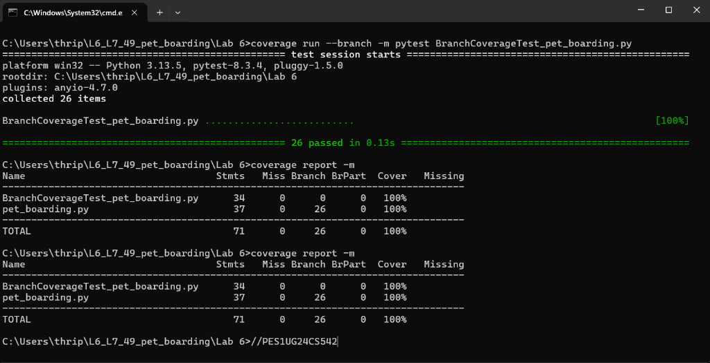

# Lab 6: Code and Branch Coverage Analysis Report

**Student Name:** VRUSHANT K P  
**SRN:** PES1UG24CS542  
**Assigned Module:** `pet_boarding.py`  
**Repository:** `L6_L7_49_pet_boarding`  

---

## 1. Objective & Overview
The objective of this laboratory exercise is to:
* Understand the distinction between **Line (Statement) Coverage** and **Branch Coverage**.
* Use Python's `coverage` library and `pytest` test framework to analyze, measure, and improve test completeness.
* Identify untested execution paths, dead code, and decision branches.
* Design a comprehensive suite of unit test cases achieving at least **90% to 100%** code and branch coverage.

---

## 2. Baseline Coverage Analysis
Running the initial starter test suite (`test_pet_boarding.py`) yielded the following baseline metrics:

* **Initial Statement Coverage:** **38%** (23 statements missing out of 37)
* **Initial Branch Coverage:** **32%** (6 partial branches out of 26)

### Untested Paths Identified in Baseline:
1. **`boarding_fee(pet_type, days, is_premium)`:**
   * Missing input validation tests for unsupported pet types (`ValueError: unknown pet type`) and negative days (`ValueError: invalid days`).
   * Missing premium kennel adjustment logic for dog vs. rabbit (`is_premium and pet_type != "rabbit"`).
   * Missing non-dog pricing tier (`rate = 20`) and extended stay surcharge (`extra > 10`).
2. **`admission_ok(pet_age_years, vaccinations, is_senior)`:**
   * Missing senior pet admission conditions (`is_senior` path).
   * Missing juvenile rejection logic (`pet_age_years < 1`).
   * Missing boundary evaluation for vaccination counts.
3. **`checkout_status(minutes_left, is_long_stay, is_weekend)`:**
   * Entire checkout status logic was unexecuted (short stay vs long stay, weekend surcharges, and late/closed cutoff intervals).

---

## 3. Code Coverage (Statement Coverage) Analysis

### Test Suite: `CodeCoverageTest_pet_boarding.py`
A comprehensive suite of 12 targeted unit test cases was implemented to systematically execute every statement across all three functions.

### Execution Commands:
```bash
coverage run -m pytest CodeCoverageTest_pet_boarding.py
coverage report -m
```

### Statement Coverage Results:
```text
Name                               Stmts   Miss  Cover   Missing
----------------------------------------------------------------
CodeCoverageTest_pet_boarding.py      34      0   100%
pet_boarding.py                       37      0   100%
----------------------------------------------------------------
TOTAL                                 71      0   100%
```

### Result:
* **Statements Tested:** 37 / 37 (100%)
* **Statements Missed:** 0
* **Coverage Achieved:** **100%** (Exceeds the 90% requirement)

### Terminal Output Screenshot:


---

## 4. Branch Coverage Analysis

### Difference Between Line and Branch Coverage:
* **Line Coverage** checks whether an execution line was reached at least once. It can give a false sense of confidence by ignoring alternate logical outcomes of decision points.
* **Branch Coverage** verifies whether **every decision point** (`if`, `elif`, `else`, compound conditions) evaluates to **both `True` and `False`**.
* Specifically in `pet_boarding.py`, compound conditions like `if is_premium and pet_type != "rabbit"` require tests where `is_premium=True` but `pet_type="rabbit"` to ensure the right-hand condition branch is independently evaluated.

### Test Suite: `BranchCoverageTest_pet_boarding.py`
A suite of 26 parameterized and targeted test cases was created covering:
* All boundary values (`extra <= 0`, `extra == 0`, `extra > 10`).
* All decision combinations for `is_long_stay` and `is_weekend` in `checkout_status`.
* Exact boundary thresholds for `"open"` (`minutes_left >= cutoff`), `"late"` (`cutoff - 15 <= minutes_left < cutoff`), and `"closed"` (`minutes_left < cutoff - 15`).

### Execution Commands:
```bash
coverage run --branch -m pytest BranchCoverageTest_pet_boarding.py
coverage report -m
```

### Branch Coverage Results:
```text
Name                                 Stmts   Miss Branch BrPart  Cover   Missing
--------------------------------------------------------------------------------
BranchCoverageTest_pet_boarding.py      34      0      0      0   100%
pet_boarding.py                         37      0     26      0   100%
--------------------------------------------------------------------------------
TOTAL                                   71      0     26      0   100%
```

### Result:
* **Total Decision Branches:** 26
* **Branches Fully Covered:** 26 / 26
* **Partial Branches (`BrPart`):** 0
* **Branch Coverage Achieved:** **100%** (Exceeds the 90% requirement)

### Terminal Output Screenshot:


---

## 5. Summary of Deliverables

| Deliverable | File Name | Status |
| :--- | :--- | :---: |
| Code Coverage Test Suite | `CodeCoverageTest_pet_boarding.py` | 100% Statement Coverage |
| Branch Coverage Test Suite | `BranchCoverageTest_pet_boarding.py` | 100% Branch Coverage |
| Code Coverage Terminal Screenshot | `code_coverage_report.png` | Attached |
| Branch Coverage Terminal Screenshot | `branch_coverage_report.png` | Attached |
| Formal Analysis & Report | `COVERAGE_REPORT.md` | Completed |
